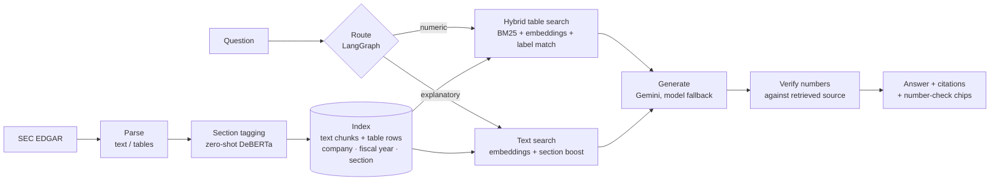

# 🔎 FilingLens

**Ask analyst-style questions over SEC filings. Get cited answers where every number is checked against the source.**

FilingLens is an agentic RAG system over SEC 10-K filings. It understands both prose *and* financial tables, routes each question to the right retrieval strategy, and verifies the numbers in the generated answer against the retrieved evidence before showing it. If the filings don't contain the answer, it says so instead of guessing.

```
Question → Route → Retrieve evidence → Generate → Verify numbers → Cited answer
```

> **Scope today:** Apple and Microsoft 10-Ks (3 fiscal years each). Text + table retrieval. 10-Q filings are downloaded and parsed; indexing is in progress. Chart/visual retrieval and 8-K are roadmap items, not built.

---

## Why it exists

Plain RAG over filings fails in two predictable ways:

1. **Table rows get crowded out.** Fluent prose chunks outscore the one financial-statement row a question needs.
2. **LLMs misquote numbers.** A confident answer with a wrong figure is worse than no answer.

FilingLens addresses both with row-level table chunking, hybrid retrieval, and a post-generation numeric verification step.

## Architecture



| Stage | What it does | File |
|---|---|---|
| Ingest | Downloads filings from SEC EDGAR by ticker and form type | `edgar_ingest.py` |
| Parse | Splits filings into tables and ≤1500-char text chunks | `parse_filing.py` |
| Classify | Tags text chunks with their 10-K section (zero-shot DeBERTa-v3) | `classify_sections.py` |
| Table chunking | One index entry per table row, with label, period and section | `table_chunker.py` |
| Index | Embeds text + table rows (MiniLM), tagged by company and fiscal year | `build_full_index.py` |
| Retrieve | Hybrid search, company filter, segment-aware re-ranking | `hybrid_search.py` |
| Orchestrate | LangGraph: classify query → retrieve → generate → verify | `filinglens_graph.py` |
| Serve | FastAPI (`/ask`, `/health`) + web UI | `api.py`, `static/`, `frontend/` |
| Evaluate | Eval harness with main set and held-out set | `eval_harness.py` |

## Key features

**Agentic query routing.** A LangGraph node classifies each question. Numeric questions ("What was Apple's net income in 2024?") go to table-focused retrieval; explanatory ones ("Why did margins change?") go to text-focused retrieval.

**Table-aware retrieval.** Every table row becomes its own searchable unit (label, period, section), so questions about revenue, EPS, operating income, segments or year-over-year changes retrieve the exact row.

**Hybrid search.** Table retrieval fuses three signals with reciprocal rank fusion: embedding similarity, BM25 keyword match, and IDF-weighted financial-label match. It expands aliases (R&D → Research and Development, EPS → Earnings Per Share), splits multi-part questions, and demotes percentage rows when the question wants dollar amounts.

**Company and fiscal-year awareness.** The retriever detects the company in the question (Apple/AAPL/iPhone, Microsoft/MSFT/Azure…), filters to it, and prefers the filing for the requested year. It also applies a segment-aware re-rank so "Services revenue" answers from the Services row.

**Source-cited answers.** Answers cite `[Source N]`; the UI shows the retrieved sources so the evidence can be inspected.

**Numeric verification.** Numbers in the answer are extracted, normalized ($ , % parentheses), and matched against the retrieved evidence. Each is marked verified or not.

```
✓ $391,035 million     ✓ 6.8%     ✗ $405,200 million   ← flagged
```

**Refuses when unsupported.** Questions the filings can't answer (e.g. a company not in the index) are part of the eval. The system says it doesn't know.

**Model fallback.** If one Gemini model hits quota, the system switches to the next configured model.

## Results

| Eval set | Questions | Correct |
|---|---|---|
| Main (Apple + Microsoft: numeric, derived, prose, unanswerable) | 32 | **32 / 32** |
| Held-out (written after tuning: segment/margin, unanswerable) | 11 | **11 / 11** (baseline 10 / 11) |

Retrieval hit rate on answerable questions: 27 / 27. Average numeric-verification rate: 94%.

**What moved the needle** (first 12-question eval):

| Change | Score |
|---|---|
| Baseline: table-level chunks + embeddings | 6 / 12 |
| + row-level table chunking + hybrid BM25 / embedding search | 12 / 12 |

Later fixes (IDF-weighted label matching, segment-aware re-ranking, percentage-row demotion) were driven by failures on the **held-out** set, not the main set, to avoid tuning only to what I was measuring.

## Design decisions

- **Row-level table chunks.** Whole-table embeddings buried the one row a question needs.
- **Hybrid, not embeddings-only.** Embeddings miss exact line-item names; BM25 and label matching catch them.
- **Type-stratified retrieval.** Table slots are guaranteed so prose can't crowd them out.
- **Verify, don't trust.** The LLM never gets the last word on a number.
- **Separate retrieval from generation.** The LLM only sees retrieved evidence; it never searches the filing itself.

## Limitations

- Two companies, three fiscal years of 10-Ks each. Results don't claim to generalize across sectors or filers.
- Eval sets are small and written by the author. 100% is on *this* set, not a public benchmark.
- Query routing is keyword-heuristic, not learned.
- Verification checks that a number appears in the retrieved evidence. It is not a proof that the reasoning is correct.
- No chart/image understanding; no 8-K support; 10-Q indexing in progress.
- Generation uses the Gemini free tier and depends on its quotas.
- The index is local and must be rebuilt when filings are added.

## Quickstart

```bash
git clone https://github.com/brindapalanimuthu/FilingLens.git && cd FilingLens
python -m venv .venv && source .venv/bin/activate
pip install -r requirements.txt
export GEMINI_API_KEY="your_key"          # Google AI Studio free tier

# Build the data (generated files are not committed)
python edgar_ingest.py AAPL 10-K
python edgar_ingest.py MSFT 10-K
python parse_filing.py
python classify_sections.py
python build_full_index.py

# Run the API + UI
uvicorn api:app --reload                  # http://127.0.0.1:8000

# Optional: React frontend
cd frontend && npm install && npm run dev # http://127.0.0.1:5173

# Evaluate
python eval_harness.py
EVAL_SET=eval_holdout.json EVAL_RESULTS=holdout_results.json python eval_harness.py
```

## API

`POST /ask`

```json
{ "question": "What was Apple's Services revenue in 2024?" }
```

```json
{
  "answer": "...",
  "route": "table_focused",
  "model": "gemini-2.5-flash",
  "sources": [],
  "verification": [{ "number": "$391,035", "verified": true }],
  "unverified_count": 0
}
```

`GET /health` → `{ "status": "ok", "index_entries": ... }`

## Example questions

- *What was Apple's total net sales in 2024?* (table route)
- *How did Microsoft's revenue change between 2023 and 2024?* (multi-year, derived)
- *What were Apple's R&D expenses and net income in 2024?* (multi-part)
- *Why did Apple's gross margin change?* (text route)
- *What was Alphabet's revenue?* (not in index → refuses)

## Roadmap

- [x] 10-K ingestion, parsing, section tagging, hybrid retrieval, verification, eval
- [x] FastAPI + web UI
- [ ] 10-Q indexing and cross-filing questions (quarter-over-quarter)
- [ ] Learned query router
- [ ] Chart / visual retrieval
- [ ] 8-K support, more companies, persistent vector store

## Stack

Python · LangGraph · sentence-transformers (all-MiniLM-L6-v2) · rank_bm25 · Hugging Face zero-shot (DeBERTa-v3) · Gemini · FastAPI · React + Vite · SEC EDGAR

## Author

**Brinda Palanimuthu** · [GitHub](https://github.com/brindapalanimuthu)

Built for educational, research and portfolio purposes. Data from SEC EDGAR.